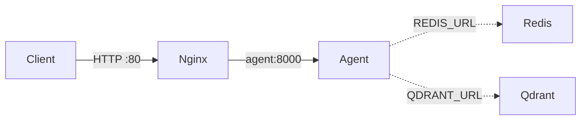

# Day 14 — Mission Answers

Ngày thực hành: 2026-11-25 (GMT+7). Kết quả dưới đây lấy từ lệnh thực sự chạy; mục chưa chạy được được ghi rõ. Không commit trong phiên làm việc này.

## Tiến độ checkpoint

| CP | Trạng thái | Bằng chứng |
|---|---|---|
| CP0 | Hoàn thành công cụ local; đã chạy Python posix trong container Docker Desktop WSL2 | Python Windows 3.11.9; Compose v2.32.4-desktop.1; Docker Engine 27.5.1; `docker run --rm hello-world` thành công |
| CP1 | Hoàn thành | Kết quả API và bảng so sánh bên dưới |
| CP2 | Hoàn thành | Hai image đã build/đo, develop container 200, Nginx /health và /ask 200 |
| CP3 | Hoàn thành | Thiếu key 401, key đúng 200; user student 10 thành công rồi 10 lần 429; giải thích cost guard bên dưới |
| CP4 | Hoàn thành bài test được yêu cầu | /health và /ready 200; SIGTERM không cắt request; kiểm lại đủ 3 container healthy, script đi qua cả 3 instance và giữ 10 messages |
| CP5 | Hoàn thành | PASS 12/12, 43/43 checks; container stop exit 0, 1.3s |
| CP6 | Hoàn thành | 200 / 200 / 401 / 200 trên Railway; đủ dashboard/running/test.png, xem DEPLOYMENT.md |
| CP7 | Hoàn thành | 10 JSON, Histogram độ dài câu hỏi, eval cuối 23/23 và không regression |
| CP8 | Hoàn thành thí nghiệm và bằng chứng | Grafana có tải; slow/error trace và log khớp; 2 alert cùng firing; CSV scale 1/3; kết quả SLO chưa đạt được ghi nguyên trạng trong BENCHMARK_REPORT.md |

## Part 1 — Localhost vs Production (CP1)

### Exercise 1.1 — Anti-patterns

1. `01-localhost-vs-production/develop/app.py:17–18`: hardcode key mẫu và chuỗi kết nối database; đổi secret phải sửa source, dễ lộ trong Git.
2. `01-localhost-vs-production/develop/app.py:34`: in key vào log; người có quyền đọc log có thể lấy secret.
3. `01-localhost-vs-production/develop/app.py:21–22`: DEBUG và MAX_TOKENS cố định; không thể cấu hình theo môi trường.
4. `01-localhost-vs-production/develop/app.py:51`: bind localhost khiến service không nhận kết nối từ ngoài container.
5. `01-localhost-vs-production/develop/app.py:52`: port 8000 cố định, không dùng PORT do nền tảng cấp.
6. `01-localhost-vs-production/develop/app.py:53`: reload luôn bật, không phù hợp vận hành production.
7. Không có /health hoặc /ready; nền tảng khó phân biệt process chết và dependency chưa sẵn sàng.
8. Dùng print không có cấu trúc; không có lifecycle cleanup rõ ràng.

### Exercise 1.2 — Chạy develop

Khởi động bằng `python -m uvicorn app:app --host 127.0.0.1 --port <cổng-trống>` trong thư mục develop để tránh reload/process phụ và xung đột cổng; dùng chính app có sẵn.

| Request | HTTP thực tế |
|---|---:|
| POST /ask?question=Hello | 200 |
| POST /ask với JSON question | 422 |
| GET /health | 404 |

Response query thành công:

```json
{"answer":"Agent đang hoạt động tốt! (mock response) Hỏi thêm câu hỏi đi nhé."}
```

Develop nhận question qua query; JSON 422 là hành vi đã quan sát, không coi là request hợp lệ của ví dụ.

### Exercise 1.3 — So sánh

Bản production được chạy bằng uvicorn với ENVIRONMENT=development; POST /ask JSON, GET /health và GET /ready đều trả 200.

| Thành phần | Develop | Production | Ý nghĩa |
|---|---|---|---|
| Config | Giá trị cố định | Settings đọc env | Cùng source có thể dùng ở dev/staging/production |
| Secret | Key mẫu trong code và log | Đọc từ env, không log key | Giảm nguy cơ lộ secret |
| Host/port | localhost:8000 | HOST/PORT có cấu hình | Nhận được traffic trong container/cloud |
| Health/readiness | Không có | /health và cờ readiness | Phân biệt process sống với sẵn sàng nhận tải |
| Logging | print | logging có các field | Dễ tìm kiếm; formatter mẫu ghép chuỗi vẫn cần cẩn thận escape JSON, Part 6 sẽ dùng json.dumps |
| Shutdown | Không có cleanup riêng | Lifespan startup/shutdown | Có chỗ đóng tài nguyên; uvicorn quản lý request đang chạy |
| Input | Query parameter | JSON, thiếu question trả 422 | Client phải dùng đúng hợp đồng của mỗi bản |

### Tự kiểm tra — Code đối chiếu và lý do

Ví dụ anti-pattern đã được bản production sửa:

```python
# 01-localhost-vs-production/develop/app.py, dòng 51–53
host="localhost",
port=8000,
reload=True

# 01-localhost-vs-production/production/app.py, dòng 196–198
host=settings.host,
port=settings.port,
reload=settings.debug,

# 01-localhost-vs-production/production/config.py, dòng 17–19
host: str = field(default_factory=lambda: os.getenv("HOST", "0.0.0.0"))
port: int = field(default_factory=lambda: int(os.getenv("PORT", "8000")))
debug: bool = field(default_factory=lambda: os.getenv("DEBUG", "false").lower() == "true")
```

- **Hardcode secret nguy hiểm:** người đọc source, lịch sử Git hoặc log có thể lấy key để gọi dịch vụ/tạo chi phí ngoài ý muốn. Xóa key khỏi phiên bản hiện tại không xóa lịch sử; key thật đã lộ cần bị thu hồi/đổi. Production đọc secret từ environment (`production/config.py:27,32`) và log request không ghi key (`production/app.py:110–115`). Environment vẫn phải được bảo vệ, không tự động làm secret an toàn nếu tiếp tục log nó.
- **Health check cần thiết:** nền tảng cần endpoint nhẹ để kiểm process còn phản hồi và quyết định restart khi liveness thất bại; readiness quyết định instance có nhận traffic được chưa. Bản production có `/health` tại dòng 135 và `/ready` tại dòng 152; bản develop trả 404 khi gọi `/health`.
- **Graceful shutdown cần thiết:** khi deploy/restart, server cần ngừng nhận request mới, cho request đang xử lý hoàn tất trong thời gian giới hạn rồi đóng tài nguyên, tránh cắt response hoặc mất công việc. Bản production đăng ký lifespan tại dòng 73, có cleanup sau `yield` tại dòng 63–67. Uvicorn quản lý drain request; `time.sleep(0.1)` trong ví dụ không tự bảo đảm hoàn tất mọi request. Bài test SIGTERM thực tế được ghi riêng ở CP4 và CP5.

## Part 2 — Docker (CP2)

### Exercise 2.1 — Dockerfile

1. Base image develop thực tế là python:3.11 (không phải slim như một đáp án mẫu cũ).
2. WORKDIR là /app; COPY/RUN tương đối thực hiện tại đó.
3. Copy requirements trước source để Docker tái sử dụng layer pip khi chỉ thay source. Nếu đặt `COPY . .` trước bước cài dependencies, một thay đổi trong source có thể làm mất cache của bước COPY và các bước phía sau, khiến pip phải chạy lại dù requirements không đổi. Dockerfile này copy từng file thay vì `COPY . .`, nhưng vẫn giữ nguyên nguyên tắc tách dependencies khỏi source.
4. CMD cung cấp lệnh/đối số mặc định, có thể thay khi docker run; ENTRYPOINT xác định executable, đối số docker run thường nối vào entrypoint; có thể thay executable bằng --entrypoint.

### Exercise 2.2–2.3 — Build và kích thước đo được

Build từ gốc repo:

```bash
docker build -f 02-docker/develop/Dockerfile -t my-agent:develop .
docker build -f 02-docker/production/Dockerfile -t my-agent:advanced .
docker images my-agent
docker image inspect my-agent:develop my-agent:advanced --format '{{.RepoTags}} {{.Size}}'
```

| Image | docker image ls | inspect .Size (bytes) | inspect size (MiB) |
|---|---|---:|---:|
| my-agent:develop | 1.67GB | 426319720 | 406.57 |
| my-agent:advanced | 240MB | 57409289 | 54.75 |

Giảm theo cùng trường inspect .Size: 86.53%, tính (develop − advanced)/develop × 100. Docker Desktop/containerd hiển thị docker image ls và inspect .Size theo cách tính khác nhau; ghi riêng hai đầu ra, không trộn chúng để tính tỷ lệ. JSON đo gốc: reports/cp2_images.json.

Đã đối chiếu lại trực tiếp bằng `docker images my-agent`: image develop ID `29e5d7639c1a` hiển thị **1.67GB**, image advanced ID `6ef39a89b973` hiển thị **240MB**, khớp file đo đã lưu; đây không phải kích thước chép từ README.

Container develop đã chạy map host 18002 → 8000; gọi `POST /ask?question=Hello` trả **HTTP 200**, ghi ở trường `develop_ask_status` trong reports/cp2_images.json. Lệnh tái hiện (hai terminal, từ gốc repo):

```bash
docker run --rm --name cp2-develop -p 18002:8000 my-agent:develop
curl -i -X POST 'http://localhost:18002/ask?question=Hello'
```

Stage **builder** của production dùng `python:3.11-slim`, cài `gcc`, `libpq-dev` và pip dependencies vào `/root/.local`. Stage **runtime** bắt đầu từ một `python:3.11-slim` mới, chỉ lấy packages qua `COPY --from=builder /root/.local /home/appuser/.local` rồi copy source/utils. Các layer chứa compiler và build dependencies của builder không được đưa sang image runtime. Dung lượng giảm còn nhờ đổi base full `python:3.11` sang slim; không quy toàn bộ phần giảm cho riêng multi-stage. Runtime chạy bằng user `appuser` thay vì root.

Kích thước theo docker image ls giảm từ 1.67 GB xuống 240 MB, tương đương khoảng 85.63% nếu quy ước 1 GB = 1000 MB (số hiển thị được làm tròn). Tỷ lệ chính xác theo inspect .Size được ghi riêng ở trên.

### Exercise 2.4 — Stack



Compose khai báo bốn service agent, redis, qdrant, nginx; agent chờ Redis/Qdrant healthy, giao tiếp qua tên service trong mạng internal. Trong app mẫu, REDIS_URL/QDRANT_URL mới là cấu hình, endpoint /ask chưa gọi hai backend đó. Stack đã chạy đầy đủ và healthy. GET http://localhost/health trả 200; POST http://localhost/ask với JSON trả 200. HTTP body/header thực tế: reports/cp2_stack.json.

Kết quả test qua Nginx đã lưu, cả hai response có header `Server: nginx`:

| Request đã kiểm tra | HTTP | Kết quả |
|---|---:|---|
| GET `http://localhost/health` | 200 | JSON có `status: ok`, `version: 2.0.0` và uptime |
| POST `http://localhost/ask`, body JSON có `question` | 200 | `{"answer":"Agent đang hoạt động tốt! (mock response) Hỏi thêm câu hỏi đi nhé."}` |

Đây là kết quả lần chạy CP2 đã ghi nhận, không phải khẳng định container còn chạy tại thời điểm đọc bài. Sau khi lưu bằng chứng đã dọn project `k5-day14-docker` bằng `docker compose -p k5-day14-docker down -v` theo RULES.


## Part 4 — API Security (CP3)

Đối chiếu [README mục Lưu ý số 6](https://github.com/ngocsangnguyen/K5-L3A-DAY14-NguyenNgocSang-2A202603444-Deployment-Benchmark-Observability/blob/main/README.md): production dùng `POST /auth/token`, tài khoản demo `student` / `demo123`, rồi dùng JWT đó cho vòng lặp 4.3. Không tự viết lại JWT. Các output dưới đây được kiểm lại ngày 2026-11-25 bằng curl.exe; server dùng app có sẵn qua uvicorn trên Windows, vòng lặp chạy trong Git Bash. Lượt đầu trước đó đã chạy trong Linux container. Key/JWT secret test sinh ngẫu nhiên qua environment, không dùng key cloud và không ghi token thật vào bài.

### Exercise 4.1 — API key

Bản develop kiểm header `X-API-Key` trong dependency `verify_api_key`. Thiếu key trả **401**, sai key trả **403** theo code mẫu Part 4, key đúng trả **200**. Agent Part 6 có hợp đồng khác: cả thiếu và sai key đều 401.

Output `curl -i` thực tế khi không có key:

```http
HTTP/1.1 401 Unauthorized
date: Wed, 25 Nov 2026 09:23:16 GMT
server: uvicorn
content-length: 67
content-type: application/json

{"detail":"Missing API key. Include header: X-API-Key: <your-key>"}
```

Output `curl -i` thực tế với key đúng (không in giá trị key):

```http
HTTP/1.1 200 OK
date: Wed, 25 Nov 2026 09:23:16 GMT
server: uvicorn
content-length: 114
content-type: application/json

{"question":"Hello","answer":"Agent đang hoạt động tốt! (mock response) Hỏi thêm câu hỏi đi nhé."}
```

### Exercise 4.2 — Lấy JWT

Đã gọi `POST /auth/token` với `student` / `demo123`, nhận access_token và dùng chính token đó ở Exercise 4.3. Trích status và body thực tế, đã che cả token lẫn phần token trong hint:

```http
HTTP/1.1 200 OK

{"access_token": "<REDACTED>", "token_type": "bearer", "expires_in_minutes": 60, "hint": "Include in header: Authorization: Bearer <REDACTED>"}
```

JWT HS256 chứa `sub`, `role`, `iat`, `exp`; server kiểm chữ ký và thời hạn. Token trả về có thời hạn 60 phút. Đổi JWT_SECRET làm token cũ không còn được chữ ký hiện tại chấp nhận. Trong ví dụ, token sai chữ ký trả 403 và token hết hạn trả 401. Đây là tài khoản demo của lab; không dùng tài khoản/mật khẩu hardcode như vậy cho hệ thống thật.

Cách lấy biến TOKEN để tự tái hiện trong Git Bash khi production đã chạy (đổi BASE theo cổng thực tế):

```bash
BASE=http://127.0.0.1:8000
LOGIN_JSON=$(curl.exe -sS -X POST "$BASE/auth/token" \
  -H 'Content-Type: application/json' \
  -d '{"username":"student","password":"demo123"}')
TOKEN=$(printf '%s' "$LOGIN_JSON" | python -c 'import json,sys; print(json.load(sys.stdin)["access_token"])')
# Không echo TOKEN hoặc dán token thật vào bài.
```

### Exercise 4.3 — Rate limit bằng vòng lặp curl

Đã chạy vòng lặp dưới đây trên một process production mới để quota ban đầu trống. Trong lần đo, BASE là địa chỉ loopback với cổng trống do runner cấp; TOKEN là JWT vừa lấy ở bước 4.2, không phải chuỗi placeholder. Trên WSL/Linux dùng `curl` thay đường dẫn curl.exe của Windows.

```bash
for i in {1..20}
do
    printf 'CP3_REQUEST:%s\n' "$i"
    /c/Windows/System32/curl.exe -sS -i --max-time 15 -X POST "$BASE/ask" \
      -H "Authorization: Bearer $TOKEN" -H "Content-Type: application/json" \
      -d '{"question":"What is Docker?"}'
    printf '\n'
done
```

Các HTTP status thực đo theo thứ tự request 1–20:

```text
[200, 200, 200, 200, 200, 200, 200, 200, 200, 200, 429, 429, 429, 429, 429, 429, 429, 429, 429, 429]
```

Output `curl -i` thực tế của **request thứ 11**:

```http
HTTP/1.1 429 Too Many Requests
date: Wed, 25 Nov 2026 09:23:20 GMT
server: uvicorn
x-ratelimit-limit: 10
x-ratelimit-remaining: 0
x-ratelimit-reset: 1795598661
retry-after: 59
content-length: 98
content-type: application/json
x-content-type-options: nosniff
x-frame-options: DENY
x-xss-protection: 1; mode=block
referrer-policy: strict-origin-when-cross-origin

{"detail":{"error":"Rate limit exceeded","limit":10,"window_seconds":60,"retry_after_seconds":59}}
```

Sliding window giữ timestamp trong deque; mỗi user được 10 request/60 giây, nên request 11 bị từ chối khi 10 timestamp trước vẫn còn trong cửa sổ. Request hợp lệ không phải chờ token hết hạn mới bị giới hạn tốc độ. Role admin dùng limiter 100/60 giây, không bỏ qua mọi giới hạn. Bản mẫu lưu RAM nên restart hoặc nhiều worker làm quota tách rời; Part 6 đã dùng Redis Lua để chia sẻ quota. Test xong đã dừng các process local.

### Exercise 4.4 — Cost guard và vì sao cần cả hai giới hạn

Rate limit bảo vệ **tốc độ** bằng số request trong cửa sổ thời gian; cost guard bảo vệ **ngân sách tiền** bằng token và giá model. Một user gọi chậm nhưng mỗi câu hỏi có prompt dài/model đắt vẫn có thể tiêu hết ngân sách; ngược lại, hàng nghìn request rất rẻ vẫn có thể làm quá tải server dù chưa hết tiền. Vì vậy cần cả hai.

Luồng của `04-api-gateway/production/app.py` và `cost_guard.py`:

1. Xác thực token để lấy username, kiểm rate limit, rồi kiểm budget trước khi gọi LLM.
2. Tính cost = input_tokens / 1000 × giá input + output_tokens / 1000 × giá output. Các giá trong file là hằng số của bài mô phỏng, không dùng làm báo giá hiện hành.
3. Sau response, `record_usage` cộng input/output tokens, request count và global cost. Bài dùng token count giả lập; tích hợp provider thật phải lấy usage của provider.
4. Cảnh báo khi user dùng từ 80% budget; user hết budget trả **402**, global hết budget trả **503** trong ví dụ này. Mặc định là 1 USD/user/ngày và 10 USD/ngày tổng cộng.
5. Mẫu Part 4 lưu RAM để minh họa, không giữ số dư qua restart hoặc chia sẻ giữa process. Record user được thay khi ngày server đổi; phần global của mẫu chưa có logic reset ngày dù có biến `_global_today`. Không coi mẫu này là bộ đếm ngân sách production hoàn chỉnh.

Đã kiểm tra riêng class CostGuard có sẵn, không sửa singleton của app: đặt budget test 0.000001 USD, kiểm lần đầu được chấp nhận, ghi 1000 input + 1000 output tokens (0.00075 USD theo giá mock), kiểm lần tiếp theo nhận `HTTPException(status_code=402)`. Đây là kiểm tra trực tiếp class, không phải output HTTP 402 từ `/ask`.

Với yêu cầu thiết kế **10 USD/user/tháng trong Redis** ở Exercise 4.4: dùng key `budget:<user_id>:<YYYY-MM theo UTC>`, kiểm `spent + estimated_cost <= 10` trước khi nhận request. Thực hiện kiểm và giữ chỗ chi phí trong một Lua script nguyên tử để nhiều worker không đồng thời vượt quota; sau khi có usage thật thì điều chỉnh phần đã giữ chỗ. Sang tháng dùng key mới, TTL dọn key cũ. Không tách GET/check/INCR thành các thao tác cạnh tranh khi cần hard cap.

Bản Part 6 đã triển khai ngân sách **chung theo ngày UTC** bằng Redis: kiểm tổng trước LLM, INCRBYFLOAT sau response, TTL dọn key cũ. Đó là giới hạn có thể vượt nhẹ khi nhiều request đồng thời vì chưa giữ chỗ estimated cost; không khẳng định bản Part 6 đã triển khai thiết kế 10 USD/user/tháng nêu trên.


## Part 5 — Scaling & Reliability (CP4)

### Exercise 5.1 — Liveness và readiness

| Endpoint | Câu hỏi cần trả lời | Cách dùng |
|---|---|---|
| `/health` — liveness | Process có còn phản hồi không? | Nền tảng có thể restart khi probe thất bại theo cấu hình |
| `/ready` — readiness | Instance có sẵn sàng phục vụ, dependency cần thiết có dùng được không? | Load balancer/orchestrator chỉ gửi traffic khi ready |

Kết quả develop đã chạy: `/health` **200**, `/ready` **200** (reports/cp4_shutdown.log). Lượt kiểm tra production qua Nginx ngày 2026-11-25, 09:27:49 UTC: cả hai endpoint **200**; `/health` có `status=ok`, `storage=redis`, `redis_connected=true` (reports/cp4_stateless.txt).

Đọc code production: nếu app đã kết nối Redis rồi Redis mất kết nối, `/health` vẫn phản hồi HTTP 200 với trạng thái degraded, còn `/ready` trả 503. Không nên restart một process vẫn sống chỉ vì dependency tạm lỗi. Mẫu Part 5 có fallback RAM khi startup không kết nối được Redis; trong trường hợp đó readiness vẫn có thể 200 nhưng không còn bảo đảm chia sẻ session. Vì vậy khi kiểm bài phải xác nhận `storage=redis`, không chỉ nhìn HTTP 200. Part 6 xử lý dependency bắt buộc bằng `/ready` 503 khi Redis lỗi.

### Exercise 5.2 — Graceful shutdown

Đã chạy `python app.py` của develop trong môi trường Linux (`os.name=posix`), gửi request `POST /ask?question=Hello` với mock delay khoảng 3 giây, rồi gửi SIGTERM sau 0.5 giây. Kết quả thật:

```text
OS=posix; /health=200; /ready=200; in-flight request after SIGTERM=200; exit=0
```

Trong [log đầy đủ](reports/cp4_shutdown.log), thứ tự là `Shutting down` → request `/ask` trả `200 OK` → `Waiting for application shutdown` → `Shutdown complete` → `Finished server process`. Request không bị cắt khi server nhận SIGTERM. Đây là kết quả một request đang xử lý, không suy rộng thành kiểm tra mọi tình huống tải.

Uvicorn quản lý ngừng nhận kết nối mới và drain request trước khi chạy cleanup của lifespan. Không gọi `sys.exit` ngay trong handler vì có thể cắt công việc đang xử lý. `SIGKILL` không cho ứng dụng cơ hội cleanup. Không khẳng định đã gọi được `/ready` trong lúc drain; endpoint có thể không còn nhận kết nối mới tại giai đoạn đó.

### Exercise 5.3 — Vì sao cần stateless

Nếu conversation nằm trong một dict RAM của instance A, request tiếp theo tới B không thấy dict đó; restart A cũng mất dữ liệu. Sticky session chỉ giữ request về một instance, không giải quyết mất state khi instance chết.

App production dùng key `session:<session_id>` trong Redis. `save_session()` ghi JSON bằng SETEX với TTL 3600 giây; `load_session()` đọc cùng key từ bất kỳ instance nào. Request đầu tạo session_id; những request sau phải gửi lại session_id đó. TTL được gia hạn khi ghi, không phải lưu vĩnh viễn. Mẫu giữ tối đa 20 messages. Test dưới đây là hội thoại tuần tự; chưa kiểm chứng cập nhật đồng thời vào cùng session, vì mẫu dùng read/modify/write thay vì thao tác lịch sử nguyên tử.

### Exercise 5.4 — Chạy 3 instance và Nginx

Đã chạy lại đúng project trong `05-scaling-reliability/production/`:

```bash
docker compose -p k5-day14-scaling up -d --build --scale agent=3
docker compose -p k5-day14-scaling ps
python test_stateless.py
```

Client Windows thực tế dùng `python -X utf8 test_stateless.py` để in được tiếng Việt; không sửa nội dung script. Lệnh kiểm container xác nhận **3 agent đang running và healthy**:

| Container | IP nội bộ trong lượt đo | Health |
|---|---|---|
| k5-day14-scaling-agent-1 | 172.19.0.4 | healthy |
| k5-day14-scaling-agent-2 | 172.19.0.3 | healthy |
| k5-day14-scaling-agent-3 | 172.19.0.5 | healthy |

Client vào `http://localhost:8080` → Nginx → agent:8000 trong mạng Compose → Redis dùng chung. Endpoint hội thoại là **POST `/chat`**, không phải `/ask` hay cổng 80 như ví dụ cũ trong CODE_LAB. Nginx có header `X-Served-By` để biết upstream thật.

Ngoài script, một session kiểm tra riêng nhận lần lượt upstream `172.19.0.5:8000` và `172.19.0.4:8000`, đều HTTP 200 và `storage=redis`. Hai IP này khớp hai container trong bảng, xác nhận traffic đi qua các container khác nhau. Không yêu cầu mẫu 5 request phải chia đều tuyệt đối cho 3 instance.

### Exercise 5.5 — Kết quả script và giải thích

Trích kết quả mới nhất của script, không chép output mẫu README:

```text
Session ID: c4996780-233b-410e-8d1e-5c27596f16fa
Request 1: [instance-3886a4]
Request 2: [instance-0c0380]
Request 3: [instance-becd1c]
Request 4: [instance-3886a4]
Request 5: [instance-0c0380]
Total requests: 5
Total messages: 10
✅ Session history preserved across all instances via Redis!
```

Script exit **0**. Runner kiểm riêng history có đúng 10 messages và role luân phiên `[user, assistant] × 5`, không chỉ dựa vào dòng in SUCCESS của script. Năm câu hỏi tạo 5 cặp hỏi–đáp; cả 3 served_by xuất hiện mà history vẫn đầy đủ, phù hợp với state được lưu chung trong Redis. Toàn bộ output, health/ready, số replica và header kiểm tra riêng nằm trong [reports/cp4_stateless.txt](reports/cp4_stateless.txt); giữ cả lượt đo cũ và lượt xác minh mới, phân biệt bằng timestamp.

Script được cấp **không tự kill instance**, đúng ghi chú số 7 trong README. Một thử nghiệm dừng instance ở lượt trước gặp timeout 15 giây, nên không lấy nó làm bằng chứng failover thành công. Kết quả trên chứng minh bài test chia sẻ session tuần tự qua nhiều instance; chưa chứng minh failover tức thời hoặc giữ dữ liệu qua restart Redis. Compose mẫu không khai báo volume Redis bền vững.

Sau khi thu bằng chứng đã dọn bằng `docker compose -p k5-day14-scaling down -v` (thêm `-v` theo RULES để xóa volume lab). Các container local này không được giữ chạy sau khi kiểm tra.


## Part 6 — Production readiness (CP5)

Đã chạy script gốc đầy đủ (không --skip-docker/--static-only) trong Linux container Docker Desktop WSL2, có Docker CLI/buildx và Docker socket, Redis tạm 127.0.0.1:16379. Dockerfile dùng một worker/container để đơn giản lifecycle; script vẫn chạy runtime bằng hai worker, xác nhận state dùng chung Redis sau restart. Redis timeout cấu hình được (connect 2s, read 3s); không retry ghi Lua để tránh tính quota hai lần. Chi phí mock được ước lượng ký tự/4; đây không phải token usage từ provider thật.

Output đầy đủ: reports/cp5_readiness.txt. Lần kiểm tra cuối chạy sau khi dừng tải observability để tách kiểm tra chức năng khỏi thí nghiệm quá tải. Các lần trước có timeout build/Redis/Docker stop khi chạy đồng thời tải nặng; không sửa script chấm.

Sau khi `.env.example` bị trở lại bản khung trong lúc làm bài, đã khôi phục đủ các biến cấu hình với API key để trống. Kiểm tra tĩnh bổ sung đạt 28/28 checks. Chế độ `--static-only` trả exit 1 vì chủ động bỏ qua runtime/Docker; kết quả hoàn thành CP5 lấy từ lần chạy đầy đủ 43/43 ở trên, không lấy chế độ nhanh làm PASS 12/12.

### Đối chiếu 12 tiêu chí với code và phép kiểm

| Tiêu chí | Phần thực hiện | Kết quả script chấm đầy đủ |
|---|---|---|
| Dockerfile | Build nhiều stage trên `python:3.11-slim`, copy virtualenv sang runtime, chạy user `agent`, có HEALTHCHECK và đọc `PORT` | Build thành công; image 63 MB theo script; container `/health` 200 |
| Compose | `agent` và `redis:7-alpine`, `REDIS_URL=redis://redis:6379/0`, `depends_on` Redis healthy | Đọc cấu hình Compose đạt |
| `.dockerignore` | Loại `.env`, cache Python và venv khỏi build context | Kiểm loại trừ đạt |
| `/health` | Trả trạng thái của process, không ping Redis | 200 khi chạy hai worker; vẫn 200 khi Redis mất kết nối |
| `/ready` | Gọi `redis_healthy()`; Redis không ping được thì ném HTTP 503 | 200 khi Redis sẵn sàng, 503 khi Redis mất kết nối |
| API key | `verify_api_key()` kiểm header `X-API-Key` so với `AGENT_API_KEY` | Thiếu/sai 401, đúng 200 |
| Rate limit | Redis Lua xóa timestamp cũ, đếm và thêm request nguyên tử; key lưu hash của API key | Với limit test 5/phút: 5 request 200 rồi 429; restart agent vẫn 429 |
| Cost guard | Đọc tổng chi phí từ Redis trước request, ghi cost mock sau response | Budget gần 0 trả 402 ngay request đầu |
| Config env | `Settings` đọc PORT, ENVIRONMENT, key, Redis URL, rate và budget; `.env.example` có đủ biến | Đọc biến runtime đạt; không hardcode secret |
| Structured logging | `JsonFormatter` dùng `json.dumps`; middleware ghi method/path/status/duration | 12 dòng log app được parse là JSON hợp lệ |
| Graceful shutdown | Uvicorn drain request, lifespan ghi shutdown và đóng Redis client | Request đang chạy vẫn 200, process exit 0; `docker stop` exit 0 trong 1.3 giây |
| Deploy config | `railway.toml` và `render.yaml` khai báo Dockerfile, healthcheck và secret qua env | Kiểm cấu hình đạt |

Điểm vào `app.main:app` được script chạy thật với **2 worker**. Dockerfile dùng **1 worker/container** để vòng đời process rõ ràng; rate limit và cost đều dùng Redis nên state không phụ thuộc worker. Script cũng kiểm Docker container khởi động khi không có Redis; khi đó `/health` vẫn hoạt động còn `/ready` báo chưa sẵn sàng.

**Vì sao hai probe khác nhau:** liveness chỉ cần biết process còn trả lời, nên lỗi Redis tạm thời không biến `/health` thành lỗi và không gây vòng restart agent vô ích. Readiness phản ánh khả năng phục vụ `/ask`, vốn cần Redis cho rate limit/cost guard; khi Redis chết, `/ready` trả 503 để hệ điều phối ngừng đưa request mới tới instance. Trong triển khai hiện tại, `redis.from_url()` tạo client lười kết nối; `/health` không gọi nó, `/ready` mới `ping()` và bắt lỗi Redis. Nếu `/ask` vẫn được gọi trực tiếp lúc Redis lỗi, rate limiter/cost guard trả 503, không lặng lẽ bỏ qua giới hạn.

Các giới hạn cần nắm: token và giá là **ước lượng của mock**, không phải usage từ provider. Cost guard kiểm trước rồi ghi sau response; các request đồng thời có thể cùng vượt qua kiểm tra trước khi chi phí được cộng, nên đây chưa phải hard cap tiền tuyệt đối. Redis rate limit dùng Lua nguyên tử để tránh lỗi cạnh tranh tương tự đối với số request. Kết quả PASS của script chứng minh các điều kiện nó kiểm, không chứng minh hệ thống đã chịu được mọi mức tải production.

```text
📋 Checklist Deliverable
     ✅ Dockerfile (multi-stage, < 500 MB)
     ✅ docker-compose.yml (agent + redis)
     ✅ .dockerignore
     ✅ Health check endpoint (GET /health)
     ✅ Readiness endpoint (GET /ready)
     ✅ API Key authentication
     ✅ Rate limiting
     ✅ Cost guard
     ✅ Config từ environment variables
     ✅ Structured logging
     ✅ Graceful shutdown
     ✅ Public URL ready (Railway / Render config)
----------------------------------------------------------------
  Result: 12/12 tiêu chí đạt · 43/43 checks passed
  🎉 PASS 12/12 — PRODUCTION READY! Deploy nào!
================================================================
```

## Part 3 — Cloud Deployment (CP6)

Đã deploy Railway: https://agent-production-a04c3e95.up.railway.app. Redis cloud trong cùng project; bốn public checks 200 / 200 / 401 / 200, xem reports/cp6_public_checks.json và DEPLOYMENT.md.

### So sánh Railway và Render

Railway dùng railway.toml với các bảng [build]/[deploy]; builder DOCKERFILE, healthcheckPath /health. CLI railway up upload source local. Redis được tạo trong project và REDIS_URL nối bằng biến reference. Render dùng Blueprint YAML services khai báo cả web service và Redis, đường dẫn Dockerfile/context theo repo; envVars hỗ trợ generateValue và fromService. Cả hai cần PORT động, secret qua env và Redis cloud để /ready trả 200. Không cần deploy cả hai để lấy điểm so sánh.

### Exercise 3.3 — Pipeline Cloud Run

cloudbuild.yaml cài dependencies và chạy pytest trước. Khi test thành công, Docker build image gắn COMMIT_SHA và latest. Sau đó push image lên registry; cuối cùng gcloud run deploy image có COMMIT_SHA lên asia-southeast1, đặt tài nguyên, min/max instances và secret reference. service.yaml mô tả cấu hình service, env/secret, concurrency và probes. Đây là phần đọc hiểu; chưa triển khai GCP và không khẳng định pipeline mẫu đã chạy.

## Part 7 — Metrics và quality gate

### CP7 local benchmark (rerun 2026-11-25)

Chạy v1 trên cổng 8001, v2 trên cổng 8002. Bốn lượt load test đều có 300 request; kết quả lấy trực tiếp từ `06-lab-complete/benchmark-observability/develop/reports/`:

| Concurrency | RPS | p95 (ms) | Error rate | SLO |
|---|---:|---:|---:|---|
| 1 | 4.02 | 240.1 | 0.67% | PASS |
| 10 | 35.18 | 512.8 | 2.33% | FAIL |
| 50 | 41.41 | 2891.5 | 0.67% | FAIL |
| 100 | 36.57 | 5563.4 | 0.67% | FAIL |

RPS không tăng tuyến tính: lượt concurrency 100 thấp hơn 50; p95 tăng mạnh khi tải cao. Client và agent cùng chạy trên host nên đây là kết quả của máy lab, không phải năng lực production.

| `MOCK_SLOW_RATE` | Average (ms) | p95 (ms) | p99 (ms) |
|---|---:|---:|---:|
| 0 | 251.0 | 547.3 | 616.5 |
| 0.03 | 285.4 | 591.8 | 1725.9 |
| 0.1 | 367.0 | 1703.4 | 1732.4 |

Percentile cao nhạy với tail latency hơn average; average che nhóm request chậm nên không phù hợp làm SLO duy nhất.

Eval v1 chạy lại đạt 1/23 (4.35%), 57.7 token/câu và cost/câu đúng $0.00041235. Giữ `eval_v2.json` (21/23) làm baseline trước khi sửa KB để không ghi đè mất dữ liệu so sánh; eval cuối hiện tại đạt 23/23, 113.0 token/câu, cost/câu đúng $0.00003413 và quality gate PASS, không regression. `eval_v2.json` được tạo trước lần chạy này vì source hiện tại đã có KB sửa. Cost/câu đúng tốt hơn cost/câu để so sánh chất lượng/chi phí vì chuẩn hóa chi phí theo số câu trả lời đạt yêu cầu, tránh đánh giá cao phiên bản rẻ nhưng trả lời sai.

Exercise 7.1: Counter http_requests_total đếm request; Gauge agent_in_flight_requests tăng/giảm theo tải; Histogram http_request_duration_seconds chia latency vào bucket. Đã thêm Histogram agent_question_length_chars và observe(len(body.question)) trước retrieval/LLM. Kiểm tra series bucket/count/sum thực tế trong reports/cp7_metrics.txt. route.path dùng template hoặc unmatched để hàng nghìn URL bot quét không tạo hàng nghìn label/time series mới; không đưa user_id, question hoặc độ dài vào label.

Exercise 7.3: eval ban đầu v1 1/23, v2 21/23. Thêm hai tài liệu JWT và HPA vào KNOWLEDGE_BASE ở cả develop và production; không sửa dataset. Eval cuối dùng --min-accuracy 1.0 --baseline reports/eval_v2.json, đạt 23/23 và không regression. Reports giữ cả ba lần eval gốc.

CI quality gate: trên pull request, cài requirements của develop, chạy agent v2 với MOCK_ERROR_RATE=0, chờ /health 200, rồi chạy python eval/run_eval.py --url http://localhost:8002 --min-accuracy 0.85 --baseline <baseline đã được chấp nhận>. Script exit 1 nếu accuracy dưới ngưỡng hoặc một câu baseline đúng nay sai; CI phải giữ exit code, không dùng continue-on-error hay || true. Đặt job này làm required status check trong branch protection thì PR không merge khi check fail; chỉ có file workflow mà chưa bật required check thì chưa bảo đảm chặn merge. Bản nộp yêu cầu cuối 100%, cao hơn quality gate ví dụ 85%.

Đã thực chạy thêm v1 với baseline v2 để kiểm chứng cơ chế chặn: `python eval/run_eval.py --url http://localhost:18001 --min-accuracy 0.85 --baseline reports/eval_v2.json`. Kết quả 1/23, 20 regression, quality gate FAIL, process exit **1**; output trong reports/cp7_quality_gate.txt. Đây là phép thử gate thất bại có chủ đích; không thay thế ba JSON eval so sánh trong báo cáo.

## Part 7 — Observability stack (CP8)

Exercise 7.4: stack chạy với project `k5-day14-observability`, load 30 users / spawn 5. Snapshot 2 instance lúc 08:59:00 UTC: p95 1.906s và avg 0.631s; traffic 7.258/7.676 req/s, gần đều. Input tokens/s 894.255 lớn hơn output 465.635 vì input có context retrieval. Nginx trả 404 cho `/metrics`; Prometheus scrape trực tiếp agent nội bộ. Chi tiết câu trả lời và ảnh: BENCHMARK_REPORT.md mục 4.

Exercise 7.5: trace chậm `da2ef3a961f1af318a25fbec20b33d85` dài 1733.560 ms; span chat chiếm 1699.686 ms (98.05%). Trace lỗi `b52382e1c2d179ed7b67c662d59bb9a9` có event exception của mock LLM 503. Đã lưu JSON gốc, log cùng trace_id và hai ảnh Jaeger.

Exercise 7.6: promtool test rules SUCCESS. Tăng error rate lên 0.2 và slow rate lên 0.3 cùng một lượt trên 2 instance, giữ Locust 30 users. Hai alert AgentHighErrorRate / AgentHighLatencyP95 cùng firing; lần đầu quan sát sau 168.7s / 229.4s tính cả recreate và ramp-up. Đã ghi rõ đây là fault kết hợp, không phải hai phép đo cô lập. Timeline: reports/cp8_chaos.json; ảnh: screenshots/prometheus-alert-firing.png.

Exercise 7.7: Locust headless 100 users / spawn 10 / 2 phút cho 1 và 3 instance, dùng `run --no-deps` để không tự đổi số replica. Hàng POST /ask đo được RPS 14.05 → 33.99; p95 10000 → 6900 ms; failure 24.95% → 3.11%. Cả hai còn vi phạm SLO; báo cáo giữ số liệu lỗi thật, phân biệt metric từ agent với 502/504 do Nginx. Đủ JSON/CSV và 7 ảnh yêu cầu. Sau thu bằng chứng, trả env về ban đầu và dọn stack local theo RULES; giữ Railway cho chấm bài.

### Câu hỏi thảo luận

1. HTTP 200 và latency tốt không bảo đảm nội dung đúng. Cần golden eval/quality gate, đánh giá online trên mẫu và feedback người dùng; v1 là ví dụ lỗi chất lượng không nhất thiết làm alert hạ tầng đỏ.
2. Pull giúp hệ quan sát kiểm soát chu kỳ thu thập và đo khả năng scrape từng target. Với instance rất ngắn hạn hoặc scale về 0, cần collector/exporter tích hợp nền tảng và lưu telemetry ngoài instance; không dùng `up` của instance không tồn tại để kết luận lỗi người dùng.
3. Label user_id của 100000 user nhân với route/status/model sẽ làm số time series tăng rất mạnh, tốn RAM/storage/query và có nguy cơ lộ định danh. Giữ label ít giá trị, dùng log/trace khi cần tra request cụ thể.
4. Trace mọi request tốn CPU, network và storage. Sampling 10% giảm chi phí nhưng có thể bỏ lỡ lỗi hiếm; cần thiết kế sampling giữ lỗi/trace chậm khi có thể, và không dùng số trace đã sample làm tổng request.
5. `for: 0s` có thể báo vì spike ngắn hoặc nhiễu scrape; `for: 30m` phát hiện sự cố quá chậm. Chọn thời gian theo SLO, độ nhiễu và mức độ nghiêm trọng; thời gian phát hiện còn có cửa sổ rate và chu kỳ evaluation.

## AI log

- Yêu cầu rà soát CP5. AI đối chiếu README Part 6, source hiện tại và output chấm gốc đã chạy đầy đủ trong Linux container (PASS 12/12, 43/43), kiểm checker không bị sửa và không còn TODO trong các file triển khai. Bổ sung bảng 12 tiêu chí và giải thích health/readiness, worker, Redis, giới hạn cost guard vào MISSION_ANSWERS.md. Không chạy lại full grader vì source Part 6 không đổi kể từ lần PASS.

- Yêu cầu rà soát CP4. AI đọc app develop/production, Compose, Nginx và script test; đối chiếu log SIGTERM POSIX đã có, không chạy lại phép đo shutdown đã đạt. Chạy lại stack đúng project với --build --scale agent=3, kiểm 3 container healthy, chạy script gốc qua 3 instance với đủ 10 messages/exit 0 và xác minh header upstream của session riêng. Bổ sung phần 5.1–5.5 trong MISSION_ANSWERS.md, nối output mới vào reports/cp4_stateless.txt, ghi rõ giới hạn của test và dọn stack. Không sửa source Part 5, người học cần tự chạy và giải thích trước khi nộp.

- Yêu cầu rà soát CP3 theo README mục 6. AI gọi curl.exe thực tế cho API key 401/200, lấy JWT student qua /auth/token, chạy vòng lặp curl trong Git Bash đạt 10 lần 200 rồi 10 lần 429; kiểm riêng CostGuard chặn budget bằng HTTPException 402. Đã thay output Part 4 bằng lần đo mới, che access_token và hint, bổ sung lệnh tái hiện và phân biệt budget mẫu RAM/ngày với thiết kế Redis/tháng. Chỉ sửa MISSION_ANSWERS.md trong repo.

- Yêu cầu đối chiếu CP2. AI kiểm lại 4 câu hỏi Exercise 2.1, hai Dockerfile, Compose/Nginx và JSON test đã lưu; gọi lại `docker images`/`docker image inspect` trên image hiện có, xác nhận 1.67GB và 240MB khớp số đo. Bổ sung giải thích cache, builder/runtime, công thức phần trăm và bảng test Nginx vào Part 2. Không build hay khởi động lại stack.

- Yêu cầu xác nhận riêng CP1. AI đối chiếu lại hai app và config, sửa số dòng anti-pattern trong Part 1 cho đúng file hiện tại; bổ sung đoạn code develop/production đối chiếu và giải thích secret, health check, graceful shutdown. Không thay source app; giữ nguyên kết quả API đã thực chạy trước đó.

- Yêu cầu AI đọc repo, giải thích checkpoint, sau đó thực hiện tuần tự, tiếp tục file có sẵn, chỉ tạo file cần thiết và không commit. AI đối chiếu README/RULES/CHECKPOINTS/RUBRIC, kiểm tra công cụ và chạy API CP1–4. Đã triển khai Part 6 và kiểm bằng script gốc đầy đủ (PASS 12/12, 43/43), đo 7 load test, 3 eval, kiểm gate v1 regression exit 1 và deploy Railway. Đã sửa KB JWT/HPA, thêm Histogram, sửa đường dẫn package trong Dockerfile observability; không sửa checker/dataset. CP8 có CSV xác nhận replica, JSON thời gian hai alert firing, trace/log khớp và screenshot UI thật. CUA gặp timeout; người học cho phép dùng Playwright và trực tiếp đăng nhập Railway để chụp dashboard. AI điền ba tài liệu nộp, đối chiếu số đo, kiểm secret và dọn stack local; không commit. Người học cần tự đọc, chạy lại và giải thích code/số liệu trước khi nộp. Chưa ghi nhận người học đã tự kiểm tra hoặc tự sửa code.
